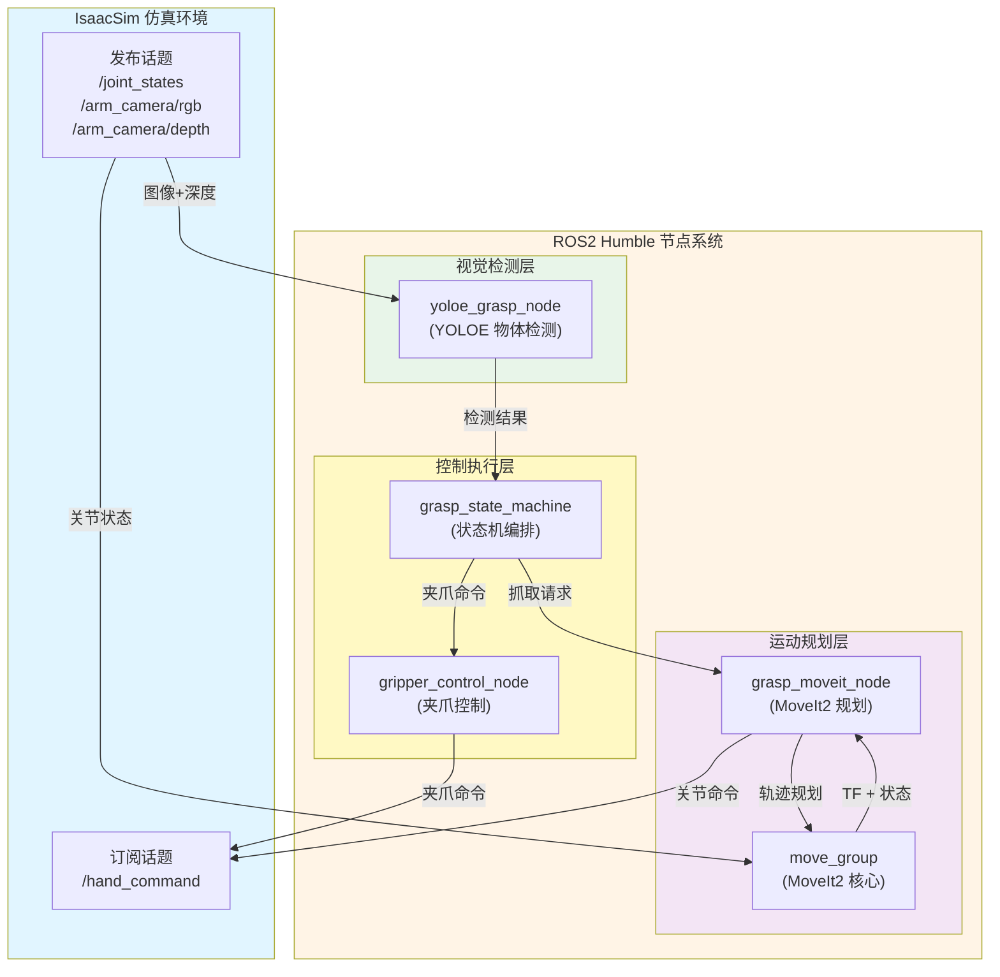
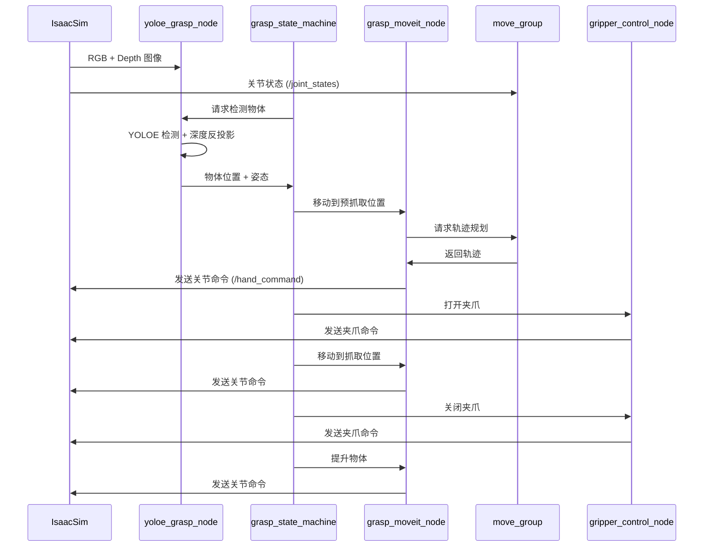
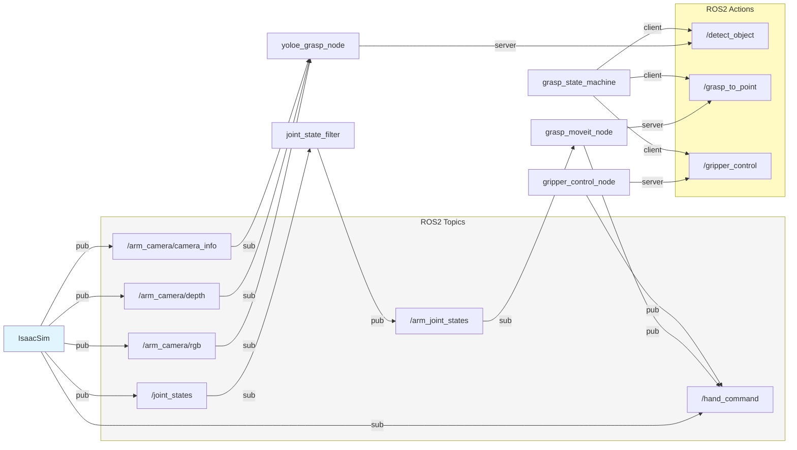

# Bobac 机器人抓取系统 - ROS2 Humble

元创兴科 Bobac 机器人在 IsaacSim 中的 ROS2（Humble）仿真抓取系统。

完整流程：**视觉识别 → 抓取点生成 → MoveIt2 运动规划 → 关节命令下发 → 夹爪控制**

**注意：本文档用于介绍具体的启动方式以及具体的代码远离，具体的安装下载安装依赖等操作请看：[README_SETUP.md](README_SETUP.md)**

---

## 目录

- 机器人抓取系统

  - [系统架构](#系统架构)
  - [功能z包说明](#功能包说明)
  - [依赖环境](#依赖环境)
  - [编译与安装](#编译与安装)
  - [启动流程](#启动流程)
  - [代码实现细节](#代码实现细节)
  - [接口说明](#接口说明)
  - [常用命令](#常用命令)
- Bobac3 导航系统

  - [功能概述](#功能概述)
  - [系统架构](#系统架构)
  - [包结构](#包结构)
  - [核心组件详解](#核心组件详解)
  - [数据流与处理逻辑](#数据流与处理逻辑)
  - [启动参数详解](#启动参数详解)
  - [参数配置方案](#参数配置方案)
  - [完整启动流程](#完整启动流程)
  - [代码实现细节](#代码实现细节)
  - [故障排除](#故障排除)
  - [依赖项](#依赖项)

---

## 系统架构

### 整体架构图



### 数据流程图



### 节点通信拓扑



---

## 功能包说明

### 1. **eco65b_moveit_description**

- **功能**: ECO65-B 机械臂的 URDF/SRDF 描述文件
- **内容**:
  - 机器人模型定义（link、joint）
  - 碰撞模型
  - 视觉模型
- **用途**: 为 MoveIt2 和 RViz 提供机器人模型

### 2. **eco65b_moveit_config**

- **功能**: MoveIt2 配置包
- **内容**:
  - `move_group.launch.py`: 启动 MoveIt2 核心节点
  - `kinematics.yaml`: 运动学求解器配置
  - `ompl_planning.yaml`: OMPL 规划器配置
  - `planning_pipelines.yaml`: 规划管道配置
- **启动的节点**:
  1. `joint_state_filter_node`: 过滤关节状态（只保留机械臂 6 个关节）
  2. `robot_state_publisher`: 发布 TF 树
  3. `move_group`: MoveIt2 核心规划节点

### 3. **eco65b_grasp_interfaces**

- **功能**: 自定义 Action 接口定义
- **接口**:
  - `GraspToPoint.action`: 抓取到指定点
  - `DetectObject.action`: 物体检测
  - `GripperControl.action`: 夹爪控制

### 4. **eco65b_moveit_grasp**

- **功能**: MoveIt2 运动规划与轨迹执行节点
- **节点**: `grasp_moveit_node`
- **输入**:
  - `/arm_joint_states` (JointState): 当前关节状态
  - `/grasp_to_point` (Action): 抓取目标点
- **输出**:
  - `/hand_command` (JointState): 关节命令（发送给 IsaacSim）
- **功能**:
  - 接收抓取目标点（PointStamped）
  - 调用 MoveIt2 进行运动规划
  - 将规划轨迹逐点发布到 `/hand_command`
  - 支持笛卡尔路径规划

### 5. **yoloe_grasp**

- **功能**: YOLOE 视觉检测节点
- **节点**: `yoloe_grasp_node`
- **输入**:
  - `/arm_camera/rgb` (Image): RGB 图像
  - `/arm_camera/depth` (Image): 深度图像
  - `/arm_camera/camera_info` (CameraInfo): 相机内参
- **输出**:
  - `/detect_object` (Action Server): 物体检测服务
- **功能**:
  - 使用 YOLOE 模型进行物体检测与分割
  - 从深度图反投影得到 3D 点
  - 计算物体法向量和长轴方向
  - 通过 TF 转换到 base_frame

### 6. **grasp_control**

- **功能**: 抓取控制状态机
- **节点**:
  - `gripper_control_node`: 夹爪控制节点
  - `grasp_state_machine`: 抓取状态机
  - `place_state_machine`: 放置状态机
- **功能**:
  - 编排完整的抓取流程
  - 协调视觉检测、运动规划、夹爪控制

### 7. **joint_state_filter**

- **功能**: 关节状态过滤节点
- **节点**: `joint_state_filter_node`
- **输入**: `/joint_states` (来自 IsaacSim)
- **输出**: `/arm_joint_states` (只包含机械臂 6 个关节)
- **用途**: 避免 MoveIt2 读取到底盘/夹爪等非机械臂关节

---

## 编译与安装

详细安装步骤请参考 [README_SETUP.md](README_SETUP.md)

快速编译：

```bash
cd /workspace/bobac_ws
source /opt/ros/humble/setup.bash
colcon build --packages-select eco65b_grasp_interfaces eco65b_moveit_grasp yoloe_grasp grasp_control
source install/setup.bash
```

---

## 启动流程

### 完整启动（5 个终端）

#### 终端 1: 启动 MoveIt2

```bash
cd /workspace/bobac_ws
source /opt/ros/humble/setup.bash
source install/setup.bash
ros2 launch eco65b_moveit_config move_group.launch.py
```

#### 终端 2: 启动运动规划节点

```bash
cd /workspace/bobac_ws
source /opt/ros/humble/setup.bash
source install/setup.bash
ros2 run eco65b_moveit_grasp grasp_moveit_node
```

#### 终端 3: 启动视觉检测节点

```bash
cd /workspace/bobac_ws
source /opt/ros/humble/setup.bash
source install/setup.bash
ros2 run yoloe_grasp yoloe_grasp_node \
  --ros-args \
  --params-file src/yoloe_grasp/config/pen_grasp_params.yaml
```

#### 终端 4: 启动夹爪控制节点

```bash
cd /workspace/bobac_ws
source /opt/ros/humble/setup.bash
source install/setup.bash
ros2 run grasp_control gripper_control_node
```

#### 终端 5: 启动抓取状态机

```bash
cd /workspace/bobac_ws
source /opt/ros/humble/setup.bash
source install/setup.bash
ros2 run grasp_control grasp_state_machine
```

### 放置物体（可选）

```bash
ros2 run grasp_control place_state_machine
```

## 参考资料

- [MoveIt2 官方文档](https://moveit.picknik.ai/humble/index.html)
- [ROS2 Humble 文档](https://docs.ros.org/en/humble/index.html)
- [Ultralytics YOLOE 文档](https://docs.ultralytics.com/)
- [IsaacSim ROS2 Bridge](https://docs.omniverse.nvidia.com/isaacsim/latest/ros2_tutorials/index.html)

**最后更新**: 2025-05-26
