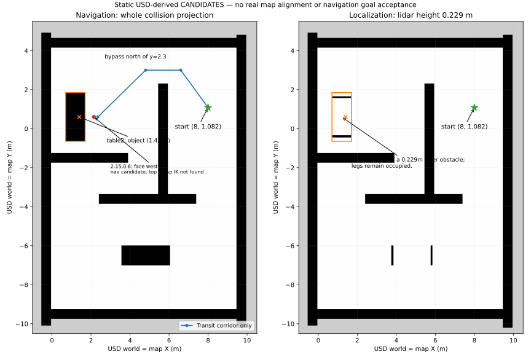

# 当前 USD 的独立世界坐标地图候选（2026-10-16）

**更新：A 已通过真实地图/定位对齐和全局路径净距门禁，但真实运动净距失败并取消，栈已由A停止。局部包络与速度/跟踪配置现已修正，尚待A重新运行验收。** 原图和旧入口保留，不自动切换公共课程。所有下列启动、定位与目标操作均由 A 安排。

## 坐标依据

输入为 A 的 `reports/navigation-scene-geometry.json`。使用 SDK USD 0.25.11 离线读取源场景及 `test_scene_bobac_6.0.course.usda`，13 个非机器人碰撞体的世界顶点与报告逐点比对，最大误差为 0 m。米制、Z-up；来源文件/机器人资产哈希和实际变换保存在 [world_scene_geometry.json](maps/world_scene_geometry.json)。远程 FlatGrid 在离线解析中出现解析警告，不能据此排除运行时附加障碍；未启动 Kit 或 ROS 控制栈。

旧 `map.yaml` 为 189×120、0.05m，覆盖 `[-4.6525,4.7975) × [-2.975,3.025)`；`map_older.yaml` 的旧图为 190×120。机器人世界坐标 `(8,1.082)` 不在此范围。当前外墙跨度约 10.5×15.1m，场景两端点距离 18.39m，大于旧图对角线约 11.20m，单位比例刚体变换不能把整个世界装进旧图。旧图可能来自局部/另一布局，但没有足够同名地标证明其配准。

即使强行以旧 AMCL 初值 `(-3.783,2.137,-1.5708)` 对齐当前初始 base_link，所得 `world_from_old_map ≈ (10.137112,4.864935,1.570764)` 也只是单点姿态锚定。物体 `(1.4,0.6)` 在该旧图坐标下约为 `(-4.265215,8.736975)`，仍在旧图外；不能把这个锚定当作地图配准。

新图**按构造定义** `x_map=x_USD_world`、`y_map=y_USD_world`、`yaw_map=yaw_world`。因此 `T_world_map` 的 SE(2) 部分为单位变换；这不是测量获得的运行时定位结论，也不增加 `world` TF 或静态 `map→odom` 发布者。

实际 `base_link` 初始静态世界位姿：

```text
x = 7.999990895390511 m
y = 1.0820035936354835 m
yaw = -0.00003577751974137747 rad   （工程上可近似 0）
```

新参数 `bobac3_navigation_world_params.yaml` 使用该 AMCL 初始位姿，AMCL z=0。A 的 `base-control-saved-scene.json` 中初始 odom 约 `(0,0,0)`，所以此时 `map→odom` 应约为 `(8,1.082,0)`，**不能把 odom 与 world 也设为同一坐标**。通式为 `T_map_odom = T_map_base × inverse(T_odom_base)`，由 AMCL 发布；A 必须在 reset 后核对实际 base_link 位姿，而非沿用机器人已运动前的初值。

## 两张地图与独立入口

| 文件 | 用途 |
| --- | --- |
| `maps/world_scene_lidar.yaml/.pgm` | `/map`，供 AMCL；在雷达 z=0.229147m 处对障碍切片，包含墙和桌腿，不把 z=0.4~0.6 的桌板视为扫描障碍。 |
| `maps/world_scene.yaml/.pgm` | `/world_obstacles`，供 global/local costmap 静态层；完整碰撞体投影，保守阻止机器人驶入桌板下面。 |
| `params/bobac3_navigation_world_params.yaml` | 独立完整参数；正确初值、两个代价地图的 world_static_layer、未知区不可通行。 |
| `launch/world_scene_navigation.launch.py` | 包含原导航节点并增加 `world_obstacle_map_server`，默认 readiness 检查全部 **10** 个 lifecycle 节点。旧入口仍为原来的 9 个。 |

两张图均为 230×320、0.05m，原点 `[-1,-10.5,0]`，覆盖 `x∈[-1,10.5)`、`y∈[-10.5,5.5)`。PGM 顶行是最大 y，栅格公式 `col=floor((x+1)/.05)`、`row=319-floor((y+10.5)/.05)`。围墙内部矩形 `(-.05,9.45) × (-9.25,4.15)` 初始置自由，碰撞格置占用，外部置未知；未知不是已验证地面。几何只支持经验证的轴对齐长方体，后续增加斜墙/其他网格必须重新提取/生成。

不预先膨胀图像；Nav2 应用 footprint/inflation。局部 obstacle layer 使用 MAX 合成，扫描清空不能擦掉保守桌板静态层。离线当前机器人矩形包络为 `x∈[-.36,.25]、y∈[-.24,.21]`（另加 .01m padding），因为碰撞包络含后置设备约 x=-.347m，原 ±.19m chassis footprint 不覆盖它。最新运输配置global/local均改用0.64m圆（见文末）；该矩形只用于解释物理几何，不再是运行footprint。这只覆盖**当前机械臂姿态**，不覆盖运动中的机械臂扫掠体；A 必须固定/核对运输姿态与真实底盘包络。



## 桌边候选与机械臂限制

table2 的桌板为 `x∈[.7,1.7]、y∈[-.65,1.85]、z∈[.4,.6]`。物体候选 `(1.4,.6)` 距东边缘 0.30m。东侧接近最短；以下 yaw=π（面向世界 -X/桌子），四元数 `(x,y,z,w)=(0,0,1,0)`。

| 用途 | map/world 目标 (x,y,yaw) | 当前保守包络到桌东边名义净距 | 说明 |
| --- | --- | --- | --- |
| 首次桌前暂驻 | `(2.35,.60,π)` | .39m | 优先用于 A 的首个桌边导航候选；不作为抓取站位。 |
| 较近桌边导航 | `(2.15,.60,π)` | .19m | 仍有底盘余量，但没有找到当前物体垂直向下抓取的数值 IK。 |
| 更近导航评估 | `(2.10,.60,π)` | .14m | 同样未找到该抓取姿态 IK，不作为已可抓取站位。 |
| 仅近桌诊断 | `(2.02,.60,π)` | .06m | 找到名义数值 IK，但**不推荐按旧 .05m 到位容差直接导航**；需额外定位/碰撞/精度论证。 |

上述净距已计入 .25m 前向包络和 .01m padding；未扣减定位误差、5cm 目标容差、栅格保守取整或姿态误差，因此不等于运行安全余量。

初始点到桌边直线会撞 `Wall_02`（x=5.45~5.95、y=-3.7~2.3）。北侧绕行候选中心线：

```text
(8,1.082) → (6.6,3.0) → (4.8,3.0) → (2.35,.6)
```

离线对每段采样 201 点，在保守栅格图中距占用/未知格至少 .50m，可容纳当前姿态约 .45m 的圆包络；这是连通性/净距证据，不是 Nav2 已算出或执行的路线。最后向 .19m/.14m 净距的桌边移动时必须保持面向桌子的指定姿态，不能套用 .45m 圆包络的绕行判据，也不能自动把中间点发成一串目标。

数值分析使用真实 URDF，零关节 FK 位置与 A 的实测模型记录匹配（`[-.086,.02062,.7725]`m）；机械臂安装偏移约 `[+.100,0,+.294]`m、安装 yaw≈π。假设物体 z=.612738m、工具偏移 .166m、link_6 Z 向下、Y 沿物体长轴世界 Y，固定随机种子 44、有界多初值 IK：2.15/2.10 站位最优位置残差约 .0886/.0519m；2.02 站位残差约 3.2e-8m。失败搜索不是不可达证明，成功 IK 也没有检查自碰撞/桌面碰撞、可操作度、相机视野或轨迹。

详细结果：[world_scene_candidates.json](maps/world_scene_candidates.json)。A 需以识别到的真实物体高度/方向和**含 table2 的 MoveIt PlanningScene**做 plan-only。可评估不同夹取姿态，或将物体移向东边缘（例如 x≈1.55~1.60，仍须核对物体完整落在桌面内），由 A 决定；本会话未修改场景或物体。不能把 `(2.15,.6,π)` 宣称为已验证抓取站位。

## A 的真实验收顺序

先在 A 的课程 overlay 安装本包。以下启动由 A 调度，避免与现有导航重复；公共 `course.launch.py` 未自动改用新入口。

```bash
export ROS_DOMAIN_ID=44
export RMW_IMPLEMENTATION=rmw_cyclonedds_cpp
ros2 launch bobac3_navigation world_scene_navigation.launch.py rviz:=true
# 另一个相同环境终端，只读：
ros2 run bobac3_navigation navigation_readiness.py --timeout 90 \
  --extra-lifecycle-node world_obstacle_map_server --report /tmp/world-navigation-ready.json
ros2 lifecycle get /world_obstacle_map_server
ros2 param get /amcl initial_pose.x
ros2 param get /amcl initial_pose.y
ros2 param get /amcl initial_pose.yaw
ros2 topic echo /amcl_pose --once
ros2 topic echo /odom --once
ros2 topic echo /map --field info --once --qos-durability transient_local
ros2 topic echo /world_obstacles --field info --once --qos-durability transient_local
```

readiness 成功只证明启动接口就绪。**发送目标前**，A 需要：

1. 核对加载场景/机器人资产哈希和 reset 后物理位姿；在 RViz 的 map 固定帧叠加激光/TF，确认机器人位于约 `(8,1.082)`，地图无 90°旋转/镜像/单位偏差。检查外墙和 x≈5.7 竖墙等至少三个方向/地标的激光重合，确认 AMCL 不因错误图而持续漂移；桌板下面应与定位图桌腿一致。
2. 确认 10 个 lifecycle active、两图尺寸/原点一致、两个 costmap 保留桌板障碍，地图外未知区不能被规划为捷径。实际地面/动态桌子/附加物体与静态投影一致；检查雷达高度/切片与发布语义。
3. 用 ComputePathToPose 做只规划检查（不执行路径），确认绕竖墙北端、碰撞自由且整体处于已知区域；A 确认可执行后才发送桌前暂驻目标 `(2.35,.6,π)`，记录 UUID/反馈/最终状态和实际到位证据。
4. 桌前目标必须 SUCCEEDED、error_code=0，实际位置/朝向与 map/world 一致且停止，无碰撞。再评估更近站位、物体识别/含桌子碰撞的机械臂 plan-only。2.02m 近桌位姿在额外验证前不发送；本候选没有建立安全且可垂直抓取的共同验收结论。

## 离线复现

项目根目录（Pillow/numpy/scipy 为离线分析依赖，不是新增 ROS 运行节点依赖）：

```bash
python3 bobac_robotac_src/src/bobac3_navigation/scripts/generate_world_map.py \
  --geometry bobac_robotac_src/src/bobac3_navigation/maps/world_scene_geometry.json \
  --output-dir /tmp/world-map-repro
python3 bobac_robotac_src/src/bobac3_navigation/scripts/analyze_world_candidates.py \
  --geometry bobac_robotac_src/src/bobac3_navigation/maps/world_scene_geometry.json \
  --urdf bobac_robotac_src/src/eco65b_moveit_description/urdf/ECO65-B_base_link_arm.urdf \
  --output /tmp/world-candidates.json
# 先按 README_SETUP 独立构建并 source 安装环境，再只做解析/测试：
ros2 launch bobac3_navigation world_scene_navigation.launch.py --show-args
python3 bobac_robotac_src/src/bobac3_navigation/tests/test_world_scene_map.py
```

未执行任何真实地图切换、定位发布、导航/机械臂目标或控制命令。

## 北绕路径运输余量修正（2026-10-16）

A 保存的 `reports/world-navigation-alignment-plan-3d.json` 证明：900 个激光命中全部在地图障碍 0.10m 内，p95 残差约0.03468m；初始定位位置误差0.0000458m、yaw误差0.0000487rad。ComputePathToPose 返回 SUCCEEDED/error_code=0，但中心净距仅0.18301m，报告中的 `circular_0_45m_envelope_clear=false` 不能被顶层 `status=passed` 覆盖。因此静态对齐通过、规划求解成功、路径运输净距通过必须分别判定。

根因是原世界配置的 global footprint 仍为矩形，SmacPlanner2D 使用圆形近似而非完整 SE2 多边形检查；原0.22m膨胀场小于0.45m运输圆包络。依据 [Nav2 足迹调参说明](https://docs.nav2.org/rolling/configuration_and_development/tuning_guide/) 与 [Jazzy 膨胀层定义](https://docs.nav2.org/jazzy/configuration_and_development/configuration_guide/core_servers/costmap_2d/costmap_plugins/inflation/)，仅提高软代价不能替代匹配圆包络的硬约束。

仅调整独立 world profile：

- global 删除矩形 `footprint`，配置 `robot_radius=0.64`、`footprint_padding=0`：0.45m运输圆 + 0.10m预留 + 0.09m离散化缓冲。0.45m包络覆盖当前带padding矩形最远角 `hypot(.37,.25)≈.4465m`。预留是当前规划策略要求，不是经真实运行证明的定位/跟踪误差上限；运输机械臂必须保持已核验姿态。
- global/local inflation 半径均0.85m；global cost_scaling_factor=3，形成更宽的软代价场；最新local也使用0.64m圆、padding=0、scaling=3，并由圆形CostCritic检查中心代价；此前保留局部矩形的方案已因A真实运动失败而替换。局部控制仍须A执行轨迹验收。
- **更正**：安装版Jazzy Smac2D不声明`smooth_path`，此前配置和“已关闭”结论无效。现使用`GridBased.smoother.max_iterations=0`及`do_refinement=false`，真实安装库离线验证零迭代不改变路径；规划终点容差由0.25m收紧至0.05m。现有BT没有SmoothPath节点；smoother server保留，但该树不调用。
- 新圆形运输配置适用于暂驻目标(2.35,.6,π)；更近2.15/2.10/2.02不能沿用该运输配置宣称可达，可能被拒绝或落在容差候选点。禁止为了抵达近桌目标临时缩小包络；近桌/抓取需A另行验证姿态、精度和规划。

新增 `scripts/check_path_clearance.py`：完全离线，不建ROS节点；读取A报告中成功规划的 `planner.points_xy`，与**完整规划图**比较，未知区域和图外均阻塞。每段插值间距≤0.01m，扣除栅格半对角线和半采样间隔，利用距离函数1-Lipschitz性质给出整段折线的保守下界；不是仅检查原路径点。通过条件为 `minimum_center_clearance_lower_bound_m≥0.55`，即扣除0.45m包络后还留≥0.10m。失败退出1，成功退出0。判据只覆盖静态几何；动态障碍、真实运输姿态、控制跟踪和转向仍由A验收。

复算证据见 [world_scene_path_clearance.json](maps/world_scene_path_clearance.json)：

| 输入 | 整段中心净距下界 | 扣0.45m包络后余量 | 0.10m预留门禁 |
| --- | --- | --- | --- |
| A已保存的真实规划路径 | 0.176533m | -0.273467m | 失败，退出1 |
| 参考北绕折线，经(6.6,3)/(4.8,3) | 0.635107m | 0.185107m | 通过，退出0；仅离线可行性参考 |

最差旧路径采样位置约(6.025,2.467)，靠近竖墙北端；新参考折线最差处在暂驻终点(2.35,.6)。**参考折线不是修改参数后Nav2实际输出，不能计作重规划通过。**

A在现有流程安排应用最新world参数、确认costmap和10个lifecycle就绪后，仅规划并运行门禁，成功前不要发送NavigateToPose。以下命令只交A运行，本会话未执行：

```bash
export ROS_DOMAIN_ID=44 RMW_IMPLEMENTATION=rmw_cyclonedds_cpp
# 使用A已构建/安装最新导航包的overlay和现有world启动流程。
ros2 param get /global_costmap/global_costmap robot_radius      # 0.64
ros2 param get /global_costmap/global_costmap footprint          # 空，不能仍覆盖robot_radius
ros2 param get /global_costmap/global_costmap inflation_layer.inflation_radius  # 0.85
ros2 param get /planner_server GridBased.smoother.max_iterations  # 0
ros2 param get /planner_server GridBased.smoother.do_refinement   # false
python3 tools/world_navigation_check.py --report /tmp/world-replanned.json
python3 bobac_robotac_src/src/bobac3_navigation/scripts/check_path_clearance.py \
  --alignment-report /tmp/world-replanned.json \
  --map bobac_robotac_src/src/bobac3_navigation/maps/world_scene.yaml \
  --report /tmp/world-replanned-clearance.json
```

新工具也安装为 `ros2 run bobac3_navigation check_path_clearance.py`，需python3-numpy/scipy/pil/yaml（已声明包依赖）。A的 `tools/world_navigation_check.py` 目前净距false仍可能顶层passed；请A串接本门禁并传播非零退出码，或在其公共工具中将净距失败纳入失败条件。该工具不在C修改范围内，本会话未修改。A还需保留新路径、实际参数、地图哈希、起点/终点和净距JSON证据，核对图与运行 `/world_obstacles` 一致；参考折线验证不能代替这个步骤。门禁通过后再由A安排真实目标执行并核验停止、无碰撞、实际到位和运行中的运输包络。

## A 真实运动失败后的局部运输配置（2026-10-16）

依据 `reports/world-navigation-integration-feedback.json` 和所列5份证据：全局重规划中心净距下界0.635107546m已通过；实际运动在(6.38018,2.42934)仅0.44528m，随后取消，最终停止在(6.11727,2.84030)附近。取消后的静止不等于到达目标或无接触。原1.25m/s每轴MPPI及1.5m/s每轴平滑器、4m/s²平滑器加速度、局部小矩形与全局0.64m圆不同，不能作为运输试验配置。

此次只调整world profile：

| 项目 | 当前运输试验值 |
| --- | --- |
| local/global圆包络 | robot_radius=0.64m，padding=0，无多边形覆盖 |
| inflation | 半径0.85m，scaling=3，两端一致 |
| MPPI/平滑器 XY速度 | 每轴±0.08m/s，合速度上界约0.11314m/s |
| MPPI/平滑器 XY加减速 | 每轴±0.15m/s²，合加速度上界约0.21213m/s² |
| 角速度/角加减速 | ±0.15rad/s、±0.30rad/s² |
| 控制/平滑/模型 | 均20Hz，model_dt=.05s，60步=3s预测 |
| 反馈 | MPPI open_loop=false；平滑器CLOSED_LOOP、scale_velocities=true、odom_duration=.1s、velocity_timeout=.25s |
| 采样 | batch=2000、XY std=.04、wz std=.06；需A核验周期无超时 |
| 停止判据 | trans_stopped_velocity=.015m/s，rot_stopped_velocity=.02rad/s |

圆形 `CostCritic.consider_footprint=false` 与圆形costmap配对，`trajectory_point_step=1`、collision_cost=1e6、weight=6；安装版内联代码将中心代价253（内切膨胀区）判为碰撞，避免原完整footprint检查绕过这层运输预留。去除冗余ObstaclesCritic；原其`cost_weight`并非该critic实际加载的权重，不依赖它形成运输约束。PathAlign权重5→20、步长5→1、offset4→2、threshold=.15；PathFollow权重20→5、offset6→2、threshold=.2；GoalCritic权重20→5、仅距终点.3m内作用；GoalAngle阈值.2m。prune_distance=.8m大于3s最大平移预测.34m。controller failure_tolerance=0，持续失败交现有BT恢复处理，不因控制失败继续宣称运行正常；恢复动作也须包含在A的运动监控中。

MPPI的critic是预测评分，不是对最终平滑/加权输出及物理执行的形式化保证；不声称以上参数自动确保真实净距。按理想恒定减速度，从最大对角速度刹停距离约0.03017m，加0.25s命令超时距离合约0.05845m；这未包括观测延迟、物理制动滞后、定位误差或低实时率，A必须实测。CLOSED_LOOP要求新鲜、sim stamp一致的odom；若反馈迟滞应修复反馈或停测，不能默默切回不匹配的高速开环。

平滑机制纠正依据：[Jazzy Smac2D源码](https://github.com/ros-navigation/navigation2/blob/jazzy/nav2_smac_planner/src/smac_planner_2d.cpp)、[真实跳过分支](https://github.com/ros-navigation/navigation2/blob/jazzy/nav2_smac_planner/src/smoother.cpp)、安装头文件SmootherParams；正确参数是 `GridBased.smoother.max_iterations=0`。MPPI参数与语义见 [Jazzy Optimizer](https://github.com/ros-navigation/navigation2/blob/jazzy/nav2_mppi_controller/src/optimizer.cpp) 和 [CostCritic](https://github.com/ros-navigation/navigation2/blob/jazzy/nav2_mppi_controller/include/nav2_mppi_controller/critics/cost_critic.hpp)。零迭代也跳过中间路径方向重算；当前Omni的PathAlign.use_path_orientations=false，终点朝向仍由Smac2D设置，A仍需核对最终yaw。

新增 `analyze_transport_trace.py` 读取A的 `trace[].world_xy` 和获准的 `planner.points_xy`，将报告中捕获的map_base起点到栅格路径首点的连接段纳入参考（避免首点量化误判），复用整段净距门禁，并要求最大点到参考折线距离≤0.05m；这是离线验收阈值，**不是MPPI可配置的硬跟踪界**。已保存旧失败轨迹复算最大偏差0.345402m、整段中心净距下界0.440299m，退出1；见 [world_transport_trace_review.json](maps/world_transport_trace_review.json)。对单条原始参考线的偏差不等于相对后续实时重规划路径的误差；A必须记录实际/每次重规划路径再分析。真实轨迹采样间的运动不能仅靠折线假定证明。

A 后续验收（C未执行）：

1. 当前机器人已不在reset初值；由A按自己的流程reset到已核验初值，或依据真实当前位姿重设定位并重新规划；不要重启后盲用(8,1.082)初值。
2. 在A独立调度的overlay构建最新包，保持sim time、Cyclone/domain44；10节点就绪后记录local/global `robot_radius`/`footprint`、MPPI速度/加速度/critic、速度平滑反馈/限幅、`GridBased.smoother.max_iterations`真实声明和值。空footprint应为`[]`；不得因rqt旧覆盖仍用小矩形。
3. 仅规划到(2.35,.6,π)，重跑整段净距门禁；新参数、真实姿态或重规划改变后必须更新证据。
4. A安排低速实跑，保存带sim时间戳的 `/odom`、`/clock`、`/cmd_vel_nav`、`/cmd_vel`、实际 `/plan` 重规划序列及真实位姿。逐轴速度、加减速和总速度要分别核验，不能用墙钟位置差替代仿真速度。确认无控制周期持续超时、odom延迟、持续饱和或打滑。
5. 整段实际中心净距下界必须≥0.55m，跟踪试验阈值0.05m；基于获准路径0.635107m下界，这给0.03m定位/测量预算后还约0.005m余量，但误差上界尚未实测。A原0.48m取消阈值过晚，需按实测速度/制动距离/采样延迟设置提前停车条件，低于0.55才取消不能保证全程达标。不要放宽验收阈值强行通过。
6. SUCCEEDED/error_code=0、实际终点xy/yaw与停止通过且全程余量通过才计真实导航成功；timeout可由A依实际低速/仿真实时率延长，不能因此提高速度或减小运输圆。

```bash
# A 在应用最新world profile、完成真定位/规划后运行；C未发送目标。
ros2 param get /planner_server GridBased.smoother.max_iterations
ros2 param get /local_costmap/local_costmap robot_radius
ros2 param get /local_costmap/local_costmap footprint
ros2 param get /controller_server FollowPath.CostCritic.consider_footprint
ros2 param get /controller_server FollowPath.ax_max
ros2 param get /velocity_smoother feedback
# 使用A真实运行产生的新报告路径，不能复用下面文件名下的旧证据：
python3 bobac_robotac_src/src/bobac3_navigation/scripts/analyze_transport_trace.py \
  --motion-report /tmp/new-transport-goal.json \
  --reference-report /tmp/new-transport-plan.json \
  --map bobac_robotac_src/src/bobac3_navigation/maps/world_scene.yaml \
  --report /tmp/new-transport-trace-review.json
```

机械臂最新A反馈亦否定旧“名义IK可作为抓取就绪”推断：原物体x1.4时2.02解的link_2与桌板碰撞；x1.65仅是假设目标，未实际移动物体。此运输配置不处理近桌抓取，不缩小运输圆来尝试这些站位。

## 最新低速反馈后的初段与闭环修正（2026-10-16）

A 最新目标被预测跟踪保护取消；记录区间中心下界1.437889m、最大偏差0.037636m，目标未到达。门槛仍是中心下界≥0.55m、偏差≤0.05m。`maps/world_startup_control_review.json` 是保存记录的离线分析，不是本次修改后的运动证据。

world profile 现在使用 `bobac3_navigation::ConnectedSmacPlanner2D`：继承原 Jazzy Smac2D 搜索及参数，加入真实请求起点与首格点之间的短连接，按≤0.01m共线细分每段，保留全部原顶点和终点，不切角或平滑。原记录连接长0.059332m，过去只被记录工具计入验收，控制器并未收到它。连接超过地图一格对角线、帧不一致、非有限值、阻塞/未知采样均拒绝。这个采样检查不替代 A 的整段净距门禁。A 必须在真正 `/plan` 中确认首点接近当次规划 start，不能只在 JSON 加字段。

Jazzy PathAlign 在最远预测点索引低于 offset 时跳过。细分后 offset=1，PathFollow offset=10（约0.1m前瞻）；加入 TwirlingCritic weight10，抑制全向运输途中无必要转动，最终位置容差内上游跳过该评分，允许 GoalAngle 对准π。半径、速度和加速度上限保持；评分仍是软约束，不是严格跟踪证明。准确起点连接使参考与控制一致，但重规划不得通过重置参考而掩盖旧路线偏离。

world launch 自动选择包内 `sim_time_velocity_smoother`，节点名仍为 `velocity_smoother`，CLOSED_LOOP、原话题及10个 lifecycle 节点不变；旧入口默认仍用上游可执行文件。适配器继承上游计算，将 wall timer 替换为 ROS 仿真时钟 timer；每次限制使用 `min(实际仿真dt,配置周期)`，不会因迟到回调放大增量。原试验20Hz墙钟对应约30Hz仿真，不能直接按 `.05s` 声称每仿真秒加速度达标。控制器仍是上游调度；适配后输出应约20Hz仿真，MPPI计算频率与物理响应仍由 A 记录核验。

闭环 odom 窗口改为.05s，max_odom_age=.15s；三轴 deadband=0，避免丢弃初段微小X纠偏。只有新的有效指令才进入计算；已有指令遇过期/零时间戳/超前超过.05s的odom，或非前进时钟时，输出零并丢弃缓存指令。该故障停车单独标为保护事件，不能冒充普通限加速度制动。暂停时ROS timer随仿真暂停；A仍须按公共安全流程在暂停/reset前停稳，并实测恢复行为。激活期间拒绝参数修改，以防上游动态频率回调重新创建wall timer；更改参数须停用并重新配置。

离线证据边界：当前 `course.usda` SHA256 为 `43ae57fc3405a83769731fa8d4ce4eb01aede5524b76099b2f148a09a0cde88a`，与旧地图记录 `9383aec5…` 不同。`test_geometry_evidence_matches_current_scene_and_asset_files` 保留失败，未替换哈希。A须确认当前加载场景，重新核对碰撞顶点、robot运输包络和map/world对应，再更新来源证据；不能据此假定碰撞几何一定变了或一定没变。

由 A 执行真实验收（C 未运行以下启动/目标步骤）：

```bash
# 在A自己的目标overlay构建；不要用C的/tmp安装代替目标环境构建
colcon build --packages-select bobac3_navigation
# reset或按当前真实位置重新定位后，用已有公共流程启动world入口
ros2 launch bobac3_navigation world_scene_navigation.launch.py rviz:=false
ros2 param get /planner_server GridBased.plugin
ros2 param get /velocity_smoother feedback
ros2 param get /velocity_smoother odom_duration
ros2 param get /velocity_smoother max_odom_age
ros2 param get /controller_server FollowPath.PathAlignCritic.offset_from_furthest
ros2 param get /controller_server FollowPath.PathFollowCritic.offset_from_furthest
ros2 param get /controller_server FollowPath.TwirlingCritic.cost_weight
```

A还须从进程命令/启动日志确认实际为 `sim_time_velocity_smoother`，日志含 `Simulation-clock CLOSED_LOOP smoother`。先验证10节点active、定位、地图来源、首点连接与每条重规划净距；保留预测保护，不放宽0.55/0.05门槛。记录原生sim-stamped odom、接收仿真时间的两级Twist、所有 `/plan` 与SDK查询时间区间。普通控制与故障/紧急零覆盖分开；测每次仿真dt、反馈年龄、物理速度及加减速，验证途中无持续自转、初段不向外加速、最终位置/朝向/停稳及 action SUCCEEDED/error0。低速起点连接可能先短暂朝西南走到格点，需按准确参考判读，不能删初始样本。

```bash
# 已保存证据的离线复查，不发ROS请求或命令
ros2 run bobac3_navigation analyze_control_feedback.py \
  --motion-report /tmp/new-motion.json --report /tmp/new-control-review.json
ros2 run bobac3_navigation analyze_transport_trace.py \
  --motion-report /tmp/new-motion.json --reference-report /tmp/new-plan.json \
  --map "$(ros2 pkg prefix --share bobac3_navigation)/maps/world_scene.yaml" \
  --report /tmp/new-transport-gate.json
```

第二个工具的静态参考不能替代按时序核对所有真实重规划。真实成功仍须目标成功、几何/跟踪/物理控制全部门禁通过；目前没有修改后运行验收证据。

兼容性依据：[Jazzy PathAlign 实现](https://github.com/ros-navigation/navigation2/blob/jazzy/nav2_mppi_controller/src/critics/path_align_critic.cpp)、[Twirling 实现](https://github.com/ros-navigation/navigation2/blob/jazzy/nav2_mppi_controller/src/critics/twirling_critic.cpp)、[上游速度平滑计时与反馈](https://github.com/ros-navigation/navigation2/blob/jazzy/nav2_velocity_smoother/src/velocity_smoother.cpp)。
